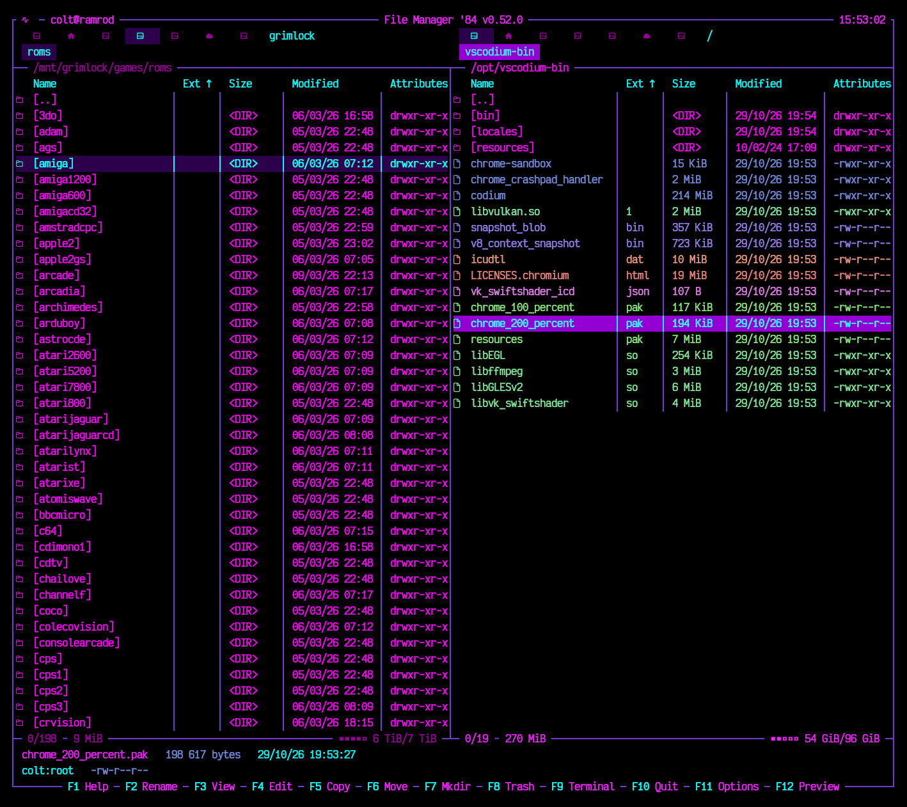
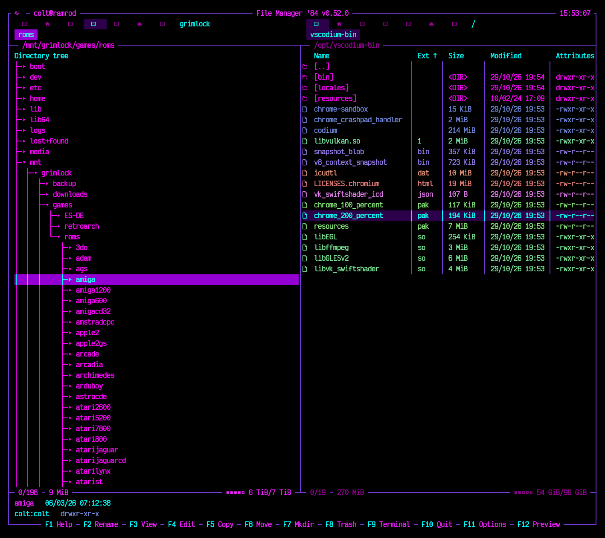
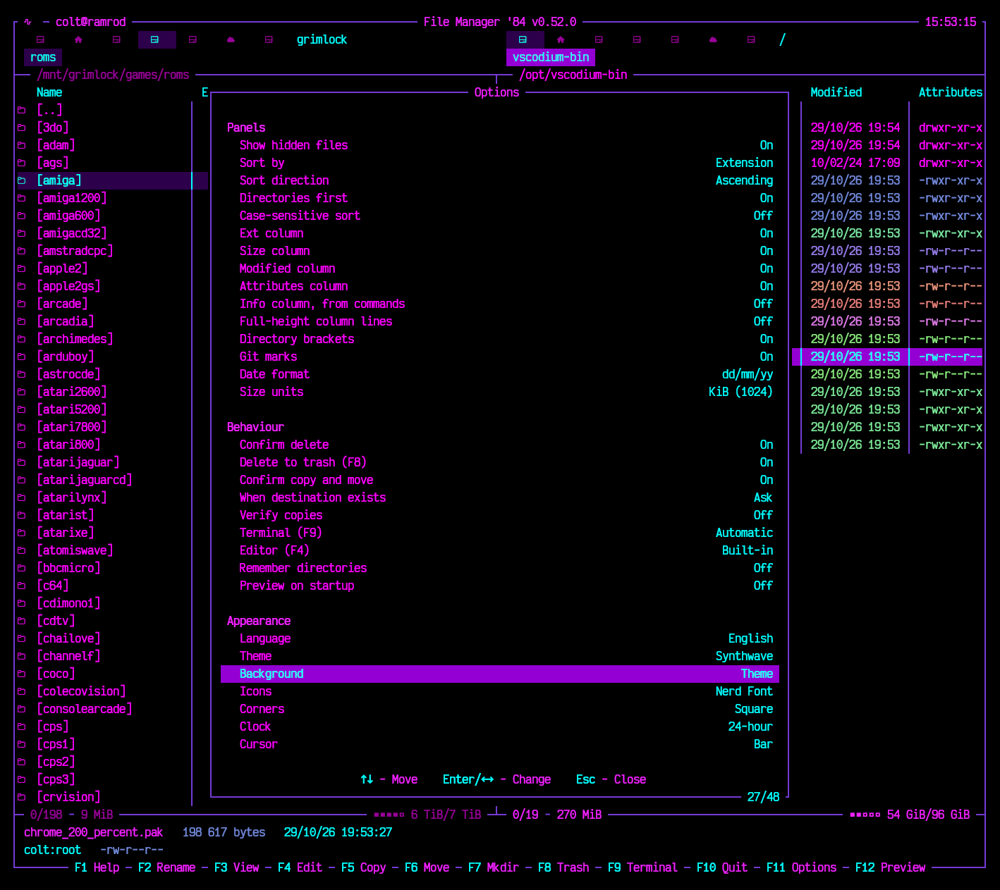
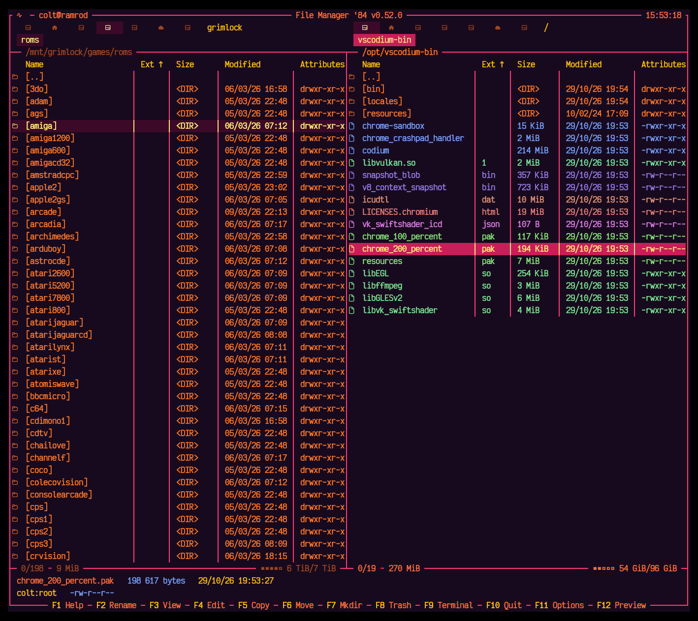
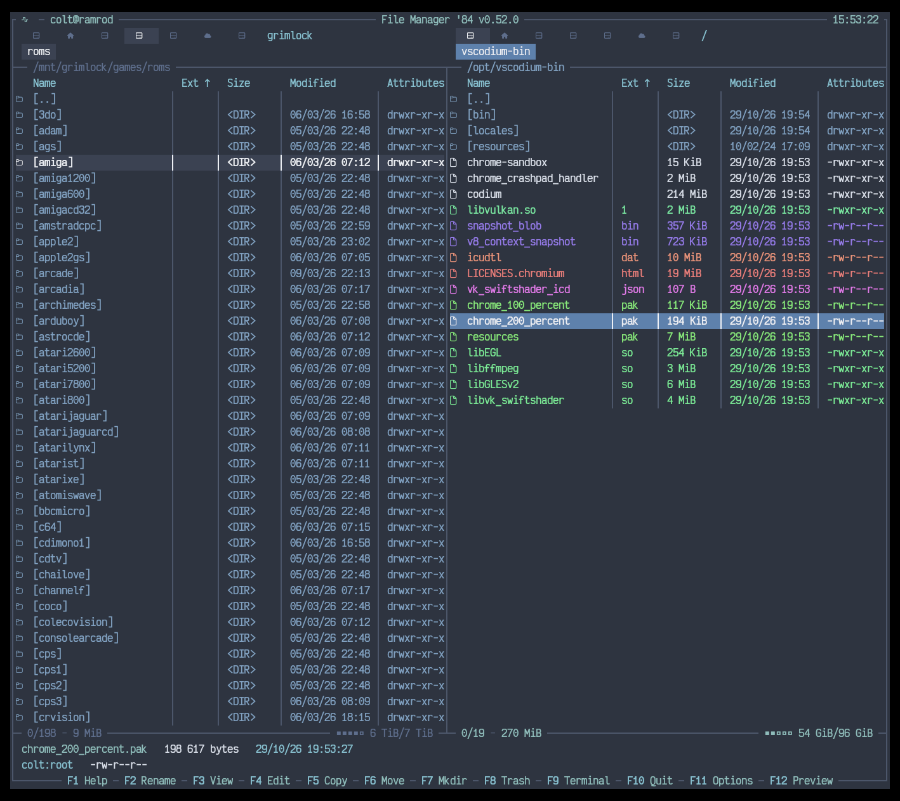
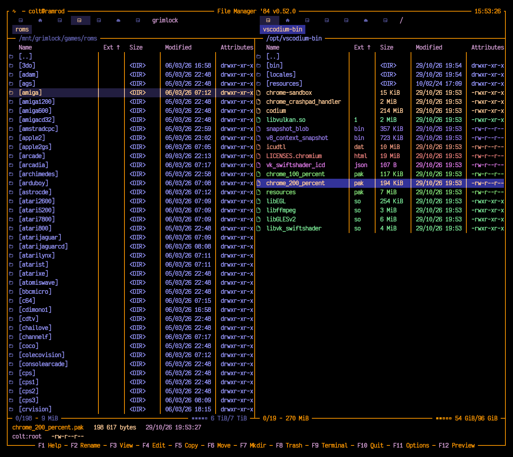
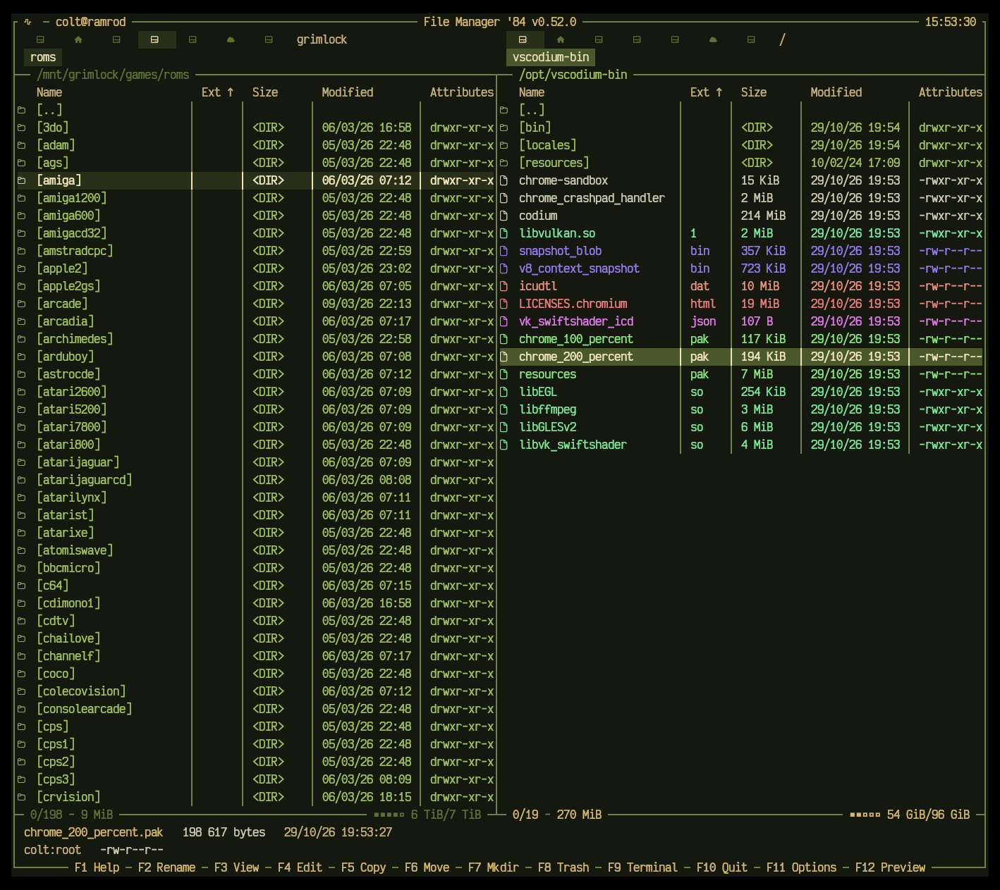
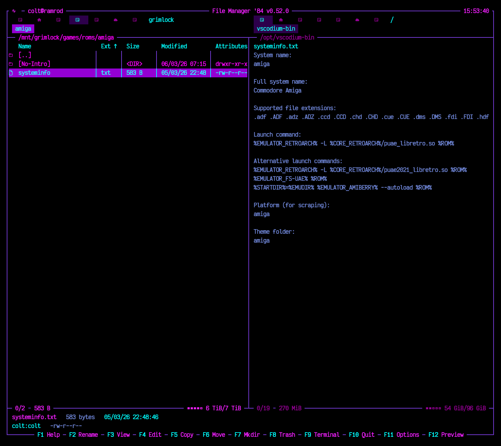
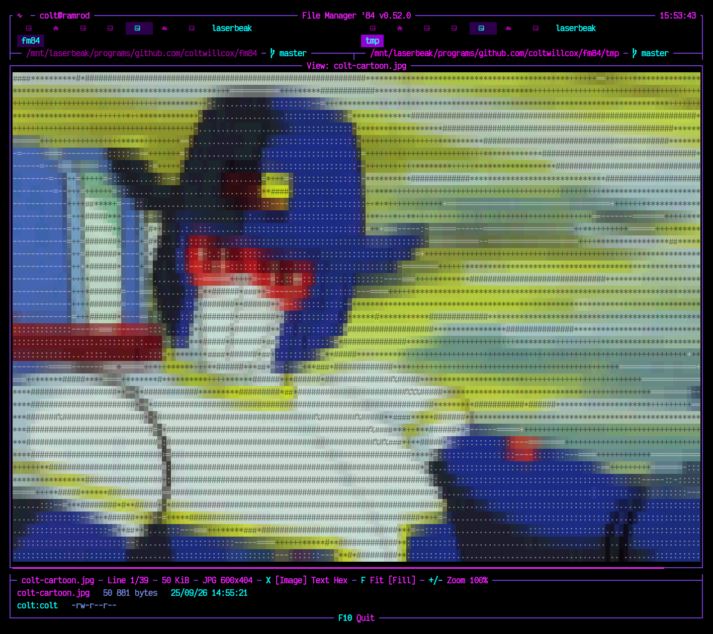
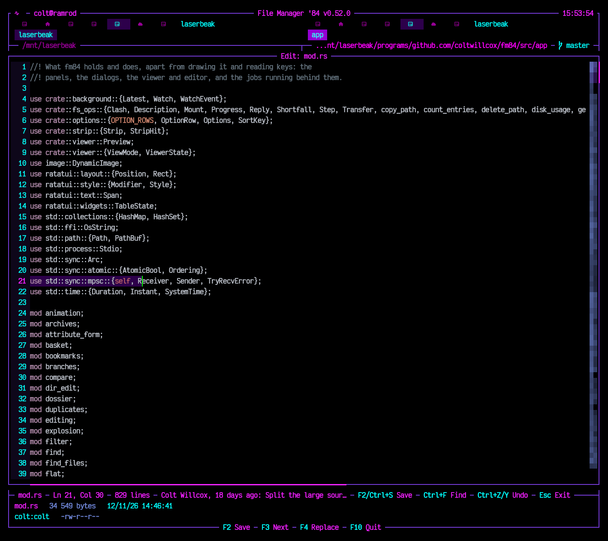

# 🌆 FM84 - File Manager '84

<div align="center">
<pre>
███████╗███╗   ███╗ █████╗ ██╗  ██╗
██╔════╝████╗ ████║██╔══██╗██║  ██║
█████╗  ██╔████╔██║╚█████╔╝███████║
██╔══╝  ██║╚██╔╝██║██╔══██╗╚════██║
██║     ██║ ╚═╝ ██║╚█████╔╝     ██║
╚═╝     ╚═╝     ╚═╝ ╚════╝      ╚═╝
</pre>
</div>

<div align="center">

💜 *A synthwave-infused dual-pane TUI file manager, forged in Rust* 💜

**Version 0.52.0** ▀▄▀▄ *Neon Dreams Edition*

</div>

---

> ⚠️ **WARNING: ALPHA SOFTWARE** ⚠️
>
> 🚧 *This is a work in progress!* 🚧
>
> Things **will** break. Features **may** eat your files. Use at your own risk.
> Back up your data. Trust no one. Not even this README.
>
> *We're still soldering the circuits on this one, choom.* 🔧

<table align="center">
<tr>
<td colspan="2" align="center" valign="top"><br><sub><b>Dual panes</b><br>198 ROM folders beside a package tree. Each pane carries its own drive strip, the Name/Ext/Size/Modified/Attributes columns, and the free space on its own filesystem.</sub></td>
</tr>
<tr>
<td align="center" valign="top" width="50%"><br><sub><b>Alt+F10 - Directory tree</b><br>The same ROM folders as the tree of the drive, ncd-style, opened down to where the panel was. Enter sends the other panel there.</sub></td>
<td align="center" valign="top" width="50%"><br><sub><b>F11 - Options</b><br>Panels, behaviour, appearance, viewer and editor. Every row changes in place with <code>Enter</code> or <code>&larr;</code>/<code>&rarr;</code>.</sub></td>
</tr>
<tr>
<td align="center" valign="top" width="50%"><br><sub><b>Outrun</b><br>One of eighteen palettes - hot pink on near-black.</sub></td>
<td align="center" valign="top" width="50%"><br><sub><b>Nord</b><br>The muted blue-grey end of the same range.</sub></td>
</tr>
<tr>
<td align="center" valign="top" width="50%"><br><sub><b>Picard</b><br>A starship's console - orange, periwinkle and tan on black, the cursor a deep blue band.</sub></td>
<td align="center" valign="top" width="50%"><br><sub><b>Military</b><br>Olive drab and khaki, with brass titles and an amber marker.</sub></td>
</tr>
<tr>
<td align="center" valign="top" width="50%"><br><sub><b>Catppuccin Latte</b><br>Light themes too, and the whole interface follows the palette, viewer and editor included.</sub></td>
<td align="center" valign="top" width="50%"><br><sub><b>F12 - Preview</b><br>The opposite pane shows whatever the cursor is on, without leaving the panel you are in.</sub></td>
</tr>
<tr>
<td align="center" valign="top" width="50%"><br><sub><b>F3 - Images</b><br>A JPEG as coloured ASCII, each character on its own colour. <code>F</code> switches Fit and Fill, <code>+</code>/<code>-</code> zoom, <code>X</code> cycles Image, Text and Hex.</sub></td>
<td align="center" valign="top" width="50%"><br><sub><b>F4 - Editor</b><br>Syntax highlighting, line numbers, selection and undo - editing fm84's own source.</sub></td>
</tr>
</table>

---

## 🔮 The Vibe

Step into the neon-lit streets of '84. Where files flow like synth waves and directories pulse with purple energy. FM84 is your retro-futuristic companion for navigating the filesystem - dual-pane style, just like the legends intended.

Built with 💜 in **Rust** using **Ratatui** + **Crossterm**.

---

## ⚡ Features

*One line each here; [USAGE.md](https://github.com/coltwillcox/fm84/blob/master/doc/USAGE.md) has them in full.*

### 🗂️ Navigation
- 📁 **Dual panes** with **tabs** in each (Ctrl+T, Ctrl+W, Alt+1…9), swapped with Ctrl+U, synced with Alt+I
- 🧭 **Go anywhere** - Ctrl+L types a path with Tab completion, Alt+←/→ back and forward, Alt+↓ every directory visited, Ctrl+D bookmarks
- 🦘 **Alt+J jump** - a few letters of any directory gone to before, in any run, the most used lately first, as zoxide ranks them
- 💿 **Drive strip** - click a mount, or Alt+F1 / Alt+F2; removable and optical media get their own icons
- 🚀 **Open with** - Shift+Enter or Ctrl+O as the system would, Alt+O to pick a program, your own per extension in `open`
- 🌿 **Git** - the branch after the path (click it to switch), and M/S/?/!/U marks on each name
- 🧑‍🔧 **Git from the panel** - Alt+G stages, unstages, discards or compares with HEAD; **R** opens any branch, tag, stash or commit as a read-only folder
- 👤 **user@host** beside the logo, reversed when root

### 🔍 Search and filter
- 🔎 **Type-ahead search** - start typing, Up/Down between matches
- 🧪 **Ctrl+S filter** - narrow the panel to a pattern as it is typed
- 🌳 **Ctrl+B flat view** - every file under the directory in one list; sort by size to find what takes the space
- 🔭 **Alt+F7 find files** - by name, content or regex, size and age, on a thread of its own; `F` feeds the results to the panel
- 👯 **Alt+D duplicates** - files the same as another, fed to the panel with all but one of each selected
- 🗂️ **Alt+R dossier** - the directory summed up: kinds of file, the largest and newest, languages, git activity, copies
- 👻 **Alt+Shift+G ghost hunt** - the files nobody has opened in two years, fed to the panel faded with a ghost beside them

### 📝 File operations
- 📋 **Copy, move, rename, delete** - F5, F6, F2, F8 to the trash, Shift+F8 for good, with progress, cancel, and an ask for names already taken
- ↩️ **Undo** - Ctrl+Z takes back the last rename, copy, move or move to the trash, refusing what has changed since
- 📝 **The directory as text** - Ctrl+E edits the names in the editor: change a line to rename, delete it to delete, duplicate it to copy
- 📼 **Mixtapes** - Alt+B gathers files from anywhere onto named tapes kept across runs, Alt+Shift+B lists them and shows one, to copy, move or pack at once
- 🗑️ **The trash as a folder** - Alt+T: look in, copy out, put back where it came from, or empty for good
- ✂️ **Split and join** - a file too big for a FAT stick split into `.001`, `.002` with a `.sha256`; F5 on the `.001` joins and checks them
- 💽 **Room checked first** - a copy that will not fit asks before it writes a byte, not halfway through
- ✔️ **Verify copies** - an F11 option that reads each copied file back from the disk and checks it, for USB sticks and network mounts
- 🏷️ **Multi-rename** - F2 on a selection, by `[N]`, `[E]`, `[C]` patterns with find, replace and case - and `[Exif:date]`, `[Tag:artist]`, `[Pdf:title]` from inside the files
- 🔗 **Links** - Alt+F5 symbolic, Tab in its dialog for hard
- 🔐 **Attributes** - Alt+A for permissions, owner, group and time
- #️⃣ **Checksums** - Alt+H for SHA-256, SHA-512 and MD5, or check a `SHA256SUMS`
- ⚖️ **Compare** - Shift+F2 selects what differs between panels, `=` diffs two files side by side
- 🔄 **Synchronize** - Alt+S plans a two-way sync, row by row, before anything runs
- 🧾 **User menu** - Alt+M runs commands of your own with `{file}`, `{files}`, `{dir}`
- ✅ **Selection** - Space, `+` / `-` by pattern, `*` to invert; Ctrl+C / Alt+C copy paths or names
- 📂 **Directory sizes** - Space on one, Alt+Shift+Enter on all, counted in the background as `du` counts
- 🗺️ **Space map** - after Alt+Shift+Enter, a bar behind each row shows what takes the space, as ncdu does
- 🧱 **Space map screen** - Alt+U draws the directory as neon blocks by size, a treemap to walk with the arrows and Enter

### 📦 Archives
- 📂 **Gone into like directories** - zip, 7z and tar in gzip, zstd, xz or bzip2; view, preview, copy out and compare inside them
- 💿 **Packages and images** - `.jar`, `.apk`, `.docx` and the other zips by another name, `.deb` packages and `.iso` images, read-only
- ✍️ **Written into** - F5 and F6 copy and move in, F7 makes, F8 deletes, all of it written whole or not at all
- 🗃️ **Alt+P packs, Alt+F9 extracts** - with a level, one archive for each, patterns to leave out, and a move; safe against paths that would escape
- 🔐 **Passwords** - zip and 7z packed with AES-256, and asked for when an encrypted one is opened

### 🖥️ Panels
- 👀 **Live** - reread when the directory changes on disk; slow or dead mounts never freeze fm84
- 🌳 **Directory tree** - Alt+F10 turns a panel into its drive's tree, ncd-style, opened and closed with the arrows; Enter sends the other panel there
- 🧱 **Columns** - Name, Ext, Size, Modified, Attributes; Ctrl+F3…F6 or a click on a heading sorts
- 🧮 **Info column** - filled by your own commands per extension: a picture's size, a song's length, a PDF's pages
- 🎨 **File colours** - by extension from a `colors` file of your own, with bold, italic and a second colour for light themes
- 🔎 **Detail lines** - full name, exact size, timestamp, owner, mode and link target under the panels
- 📊 **Status bar** - selection, disk usage and a clickable F-key bar
- 🛡️ **Any name** - not-UTF-8 names work as themselves, escape sequences in names are drawn harmless

### 🎨 Viewer (F3)
- 📄 **Text, hex, and images as coloured ASCII** - PNG, JPEG, GIF, WebP, BMP; fit, fill, zoom, drag, page through a folder
- 🔎 **Find, regex, go to line, wrap, selection** - and a prompt before anything huge is loaded
- 📜 **Follow** - `F` on a log keeps the view at its end as it grows, as `tail -f`
- 🕰️ **Time machine** - Alt+Left and Alt+Right step the file back and on through the git commits that changed it
- 🌿 **Git gutter** - a bar beside each line changed against HEAD, Alt+] / Alt+[ from change to change, and who last changed the line in the status bar. In the Editor too
- 🗺️ **Minimap** - the whole text drawn small beside it, matches lit and the view shaded; click or drag to go there. In the Editor and Compare too

### ✍️ Editor (F4)
- 🌈 **Syntax highlighting**, undo/redo, find and replace with regex, indent and comment lines
- 💾 **Safe saves** - written whole, line endings and permissions kept, edits on disk by others caught

### 👁️ Preview (F12)
- 🪞 **The other panel shows the file under the cursor** - text, hexdump or directory count, never more than 64 KiB read

### ⚙️ Options (F11)
- 🎨 **18 themes**, light ones included, and 23 languages built in
- 🧩 **Columns, sorting, date and size formats, icons, square or rounded corners, cursor, terminal, external editor, confirmations** - saved to `~/.config/fm84/config` as plain `key = value`
- 🕹️ **For fun** - an Outrun progress bar, rows that burst when deleted for good, Turbo neon with scanlines, animation - a sliding cursor, rows booting up, popups wiping open - a glow around the panel in use, a night drive when left alone, and arcade high scores in F1

---

## 🎹 Keybindings

The everyday ones - [KEYS.md](https://github.com/coltwillcox/fm84/blob/master/doc/KEYS.md) has every key, and F1 lists them inside fm84.

| Key | Action |
|-----|--------|
| `Tab` | Switch panels |
| `Enter` / `Backspace` | Open / go to parent |
| `Space` / `Insert` | Select |
| `F2` / `F3` / `F4` | Rename / view / edit |
| `F5` / `F6` / `F7` | Copy / move / new directory |
| `F8` / `Shift+F8` | Trash / delete permanently |
| `Ctrl+Z` | Undo the last file operation |
| `Ctrl+E` | Edit the names as text |
| `F9` / `F10` | Terminal / quit |
| `F11` / `F12` | Options / preview |
| `Ctrl+L` | Go to a path |
| `Ctrl+S` / `Alt+F7` | Filter / find files |
| `Ctrl+T` / `Ctrl+W` | New / close tab |

---

## 🛠️ Install, Build & Run

```bash
# 📦 Straight from crates.io
cargo install --locked fm84
```

*`--locked` builds with the exact dependency versions fm84 was tested against. The binary lands in `~/.cargo/bin`, and the same command again updates it.*

```bash
# 🦀 Clone the future
git clone https://github.com/coltwillcox/fm84.git
cd fm84

# ⚙️ Compile with cargo
cargo build --release

# 🚀 Launch into the neon grid
cargo run --release
```

### ⌨️ Command line

```bash
fm84                    # panels and tabs where you left them (or the current directory)
fm84 ~/Music            # left panel in ~/Music
fm84 ~/Music /mnt       # left in ~/Music, right in /mnt
fm84 --shell-init bash  # print cd84 for bash (or zsh, fish, powershell)
fm84 --choosedir FILE   # on quitting, write the active panel's directory to FILE
fm84 --help             # usage, and where the config lives
fm84 --version          # fm84 0.52.0
```

📖 `man ./doc/fm84.1` reads the manual page from a checkout; the release archives carry `fm84.1` beside the binary, for `/usr/local/share/man/man1`.

### 📍 cd84 - leave the shell where fm84 was left

`cd84` runs fm84 and, on quitting, leaves the shell in the active panel's directory. Add one line to your shell's startup file, then start fm84 as `cd84`:

```bash
eval "$(fm84 --shell-init bash)"                               # ~/.bashrc
eval "$(fm84 --shell-init zsh)"                                # ~/.zshrc
fm84 --shell-init fish | source                                # ~/.config/fish/config.fish
fm84 --shell-init powershell | Out-String | Invoke-Expression  # $PROFILE
```

**Shift+F10** quits without moving the shell. More in [USAGE.md](https://github.com/coltwillcox/fm84/blob/master/doc/USAGE.md#-cd84---leave-the-shell-where-fm84-was-left).

---

## 📀 Releases

Pre-built binaries beam down from the neon sky:

| Platform | Architecture | Format |
|----------|--------------|--------|
| 🐧 **Linux** | x86_64, ARM64 | `.tar.gz` |
| 🍎 **macOS** | Intel, Apple Silicon | `.tar.gz` |
| 🪟 **Windows** | x86_64 | `.zip` |

```bash
# 📥 Download from GitHub Releases
# https://github.com/coltwillcox/fm84/releases

# 🎮 Extract and run
tar -xzf fm84-v*.tar.gz
./fm84
```

*No cargo? No problem. Grab a binary and jack in.* 🔌

---

## 📦 Dependencies

- 🦀 **Rust** 1.93 or newer (2024 edition)
- 🖥️ **ratatui** - TUI framework
- ⌨️ **crossterm** - Terminal magic
- 🎨 **syntect** - Syntax highlighting
- 🖼️ **image** - Decoding pictures for the Viewer
- 🕐 **chrono** - Time vibes

---

## 🌃 Aesthetic

<div align="center">
<pre>
╔══════════════════════════════════════╗
║  VIOLET DREAMS • PURPLE HAZE • NEON  ║
║    ▓▓▓▓▓ SYNTHWAVE FOREVER ▓▓▓▓▓     ║
╚══════════════════════════════════════╝
</pre>
</div>

The default Synthwave palette channels pure 80s energy (F11 swaps it for any of 17 others, light ones included):
- 🖤 **Black background** - `#000000`
- 💜 **Violet borders** - `#743AD5`
- 🔮 **Purple selections** - `#9400D3`
- 💗 **Magenta directories** - `#FF00FF`
- 🩵 **Cyan accents** - `#00FFFF`
- 💙 **Soft purple files** - `#7289DA`

---

## 🎵 Inspired By

- 🌅 FM-84 (the band, obviously)
- 🖥️ Midnight Commander
- 🎮 Total Commander
- 🌆 Synthwave aesthetics
- 📼 That retro terminal feel

---

## 📜 License

*Ride free through the neon grid.*

Released under the [MIT License](https://github.com/coltwillcox/fm84/blob/master/LICENSE) - use it, change it, ship it, keep the notice.

---

<p align="center">
  <strong>💜 FM84 💜</strong><br>
  <em>Where every file operation feels like a synth drop</em><br>
  <code>▀▄▀▄▀▄ v0.52.0 ▄▀▄▀▄▀</code>
</p>
